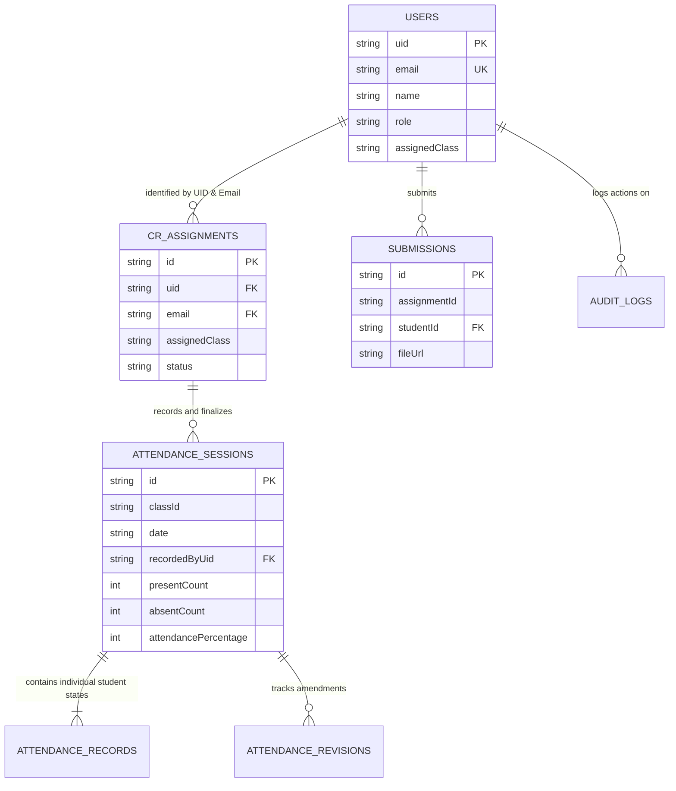

# AWKUM ClassHub — Data Model & Firestore Schema Specification

**Abdul Wali Khan University Mardan · Garden Campus**  
*Document Version: 2.1 · Status: Authoritative Database Specification*

---

## 1. Overview & Data Architecture

AWKUM ClassHub persists data in **Google Cloud Firestore** (NoSQL document database) augmented by the server-authoritative backend (`server.ts`).

### Core Design Rules
1. **Configurable Academic Data**: Subjects, courses, classes, sections, and teacher assignments are **dynamic entities**. No unchangeable list of six subjects or hardcoded teacher mapping may be embedded as permanent schema defaults.
2. **Deterministic Document IDs**: Where an entity represents a single operational event per day (such as daily whole-class attendance), the document ID is deterministically derived (e.g., `BSCS_3A_2026-10-21`) to guarantee **zero duplicate sessions**.
3. **Audit Trail Immutability**: Role changes, security events, and attendance amendments are stored as append-only audit records.

---

## 2. Firestore Collections Map

| Collection Name | Document ID Pattern | Purpose / Content | Status | Allowed Readers | Allowed Writers |
| :--- | :--- | :--- | :--- | :--- | :--- |
| `users` | Normalized Email (`name_domain_com`) or UID | Registered student, CR, teacher, and admin profiles | **Implemented** | Authenticated Users | Master Admin; Self (limited fields) |
| `crAssignments` | `cr_{email_slug}_{timestamp}` | Active & historical CR authorizations bound to UID and Gmail | **Implemented** | Master Admin; Assigned CR | Master Admin Only |
| `attendanceSessions` | `{classId}_{YYYY-MM-DD}` | Single daily whole-class attendance record per section | **Implemented** | Authenticated Students & CRs | Authorized CR & Master Admin |
| `auditLogs` | Auto-generated UID | Administrative, security, and role change audit logs | **Implemented** | Master Admin Only | Authenticated Applet (append-only) |
| `branding` | `current` | University logos, bottom graphics, and visual scales | **Implemented** | Public (read-only) | Master Admin Only |
| `submissions` | Auto-generated UID | Student coursework submissions with Cloudinary attachments | **Implemented** | Student owner & Faculty | Student owner |
| `announcements` | Auto-generated UID | Departmental notices and urgent university broadcasts | **Implemented** | Authenticated Users | Master Admin |
| `subjects` | `{code_slug}` | Dynamically configured semester subjects | **In Progress** | Public / Students | Master Admin |
| `schedules` | Auto-generated UID | Timetable class slots mapped to sections and rooms | **In Progress** | Authenticated Students | Master Admin |
| `teacherAssignments` | Auto-generated UID | Faculty subject & section assignments | **Planned** | Master Admin & Faculty | Master Admin Only |

---

## 3. Entity Schemas & Detailed Field Definitions

### 3.1 `users` Collection
**Path**: `/users/{userId}`  
**Purpose**: Stores user identities, contact details, academic program details, and current assigned roles.

```typescript
interface UserDocument {
  id: string;                      // Internal ID (e.g. 'u-admin-master' or 'u-student-01')
  uid: string;                     // Verified Firebase Authentication UID
  name: string;                    // Full legal student/faculty name
  email: string;                   // Verified university or Gmail address
  studentId?: string;              // Academic Roll Number (e.g. '23CS1001', '26SE1001')
  role: 'master_admin' | 'teacher' | 'cr' | 'student'; // Primary effective role
  roles: ('master_admin' | 'teacher' | 'cr' | 'student')[]; // Array supporting combined roles: ['student', 'cr']
  isCR?: boolean;                  // Convenience flag for fast UI evaluation
  crStatus?: 'active' | 'revoked' | 'none'; // Lifecycle status of CR privileges
  status: 'active' | 'pending' | 'suspended'; // Account standing
  registeredDate: string;          // Human-readable date of registration (e.g. 'Oct 01, 2026')
  department?: string;             // Academic department (e.g. 'Software Engineering')
  semester?: string;               // Semester standing (e.g. '1st Semester', '3rd Semester')
  assignedClass?: string;          // Assigned class/section (e.g. 'BSCS 3A', 'BSSE 1A')
  fatherName?: string;             // Guardian/father name for official university rosters
  phone?: string;                  // Contact phone number
  avatarUrl?: string;              // Profile picture URL (Cloudinary or Unsplash)
  crAcknowledged?: boolean;        // Whether user acknowledged the CR appointment modal
  createdAt?: FirebaseFirestore.FieldValue; // Server timestamp
}
```

---

### 3.2 `crAssignments` Collection
**Path**: `/crAssignments/{assignmentId}`  
**Purpose**: Authoritative record of Class Representative privilege grants, binding a verified Firebase Auth UID and Gmail account to an assigned academic section.

```typescript
interface CRAssignmentDocument {
  id: string;                      // Document key: `cr_${email_slug}_${timestamp}`
  uid: string;                     // Verified Firebase Auth UID (primary security anchor)
  email: string;                   // Verified Gmail account (administrative identification)
  name: string;                    // Student full name
  studentId: string;               // Student university roll number
  assignedClass: string;           // Academic section (e.g. 'BSCS 3A')
  status: 'active' | 'revoked';    // Authorization status
  grantedAt: string;               // ISO 8601 timestamp of grant
  grantedBy: string;               // Email of Master Admin who authorized the role
  revokedAt?: string | null;       // ISO 8601 timestamp of revocation (if revoked)
  revokedBy?: string | null;       // Email of Master Admin who revoked access
  revocationReason?: string | null;// Audit explanation for revocation
}
```

---

### 3.3 `attendanceSessions` Collection
**Path**: `/attendanceSessions/{sessionId}`  
**Document ID Pattern**: `{classId}_{YYYY-MM-DD}` (e.g., `BSCS_3A_2026-10-21`)  
**Purpose**: Stores the **single daily whole-class attendance record** for an assigned section on a specific date.

```typescript
interface StudentAttendanceRecord {
  studentId: string;               // Student internal record ID
  studentName: string;             // Student full name
  rollNumber: string;              // University roll number
  status: 'present' | 'absent';    // Attendance status
  notes?: string;                  // Optional note ('Attended', 'Late', 'Unexcused')
}

interface AttendanceRevision {
  revisionNumber: number;          // Sequential revision number (1, 2, ...)
  revisedAt: string;               // Timestamp of amendment
  revisedBy: string;               // Name of CR or Admin who made amendment
  reason: string;                  // Mandatory explanation for correction
  previousPercentage: number;      // Previous rate before correction
  newPercentage: number;           // New rate after correction
}

interface AttendanceSessionDocument {
  id: string;                      // Deterministic ID: `{classId}_{date}`
  classId: string;                 // Academic class (e.g. 'BSCS 3A')
  date: string;                    // ISO date string 'YYYY-MM-DD'
  displayDate: string;             // Human-readable date (e.g. 'Oct 21, 2026')
  dayOfWeek: string;               // Day of week ('Mon', 'Tue', 'Wed', 'Thu', 'Fri')
  recordedByUid: string;           // Firebase UID of the CR who finalized the record
  recordedByName: string;          // Name of the Class Representative
  recordedByEmail: string;         // Verified email of the Class Representative
  totalEnrolled: number;           // Total enrolled students in roster
  presentCount: number;            // Number of students present
  absentCount: number;             // Number of students absent
  attendancePercentage: number;    // Calculated percentage: (presentCount / totalEnrolled) * 100
  finalized: boolean;              // True once confirmed and locked
  finalizedAt: string;             // Timestamp of finalization
  records: Record<string, StudentAttendanceRecord>; // Map of rollNumber -> student record
  revisions?: AttendanceRevision[];// Audit history of any amendments
  pdfReportStatus?: 'generated' | 'pending'; // PDF generation status
  pdfGeneratedAt?: string;         // ISO timestamp of generated PDF
}
```

---

### 3.4 `auditLogs` Collection
**Path**: `/auditLogs/{logId}`  
**Purpose**: Append-only security audit trail tracking administrative actions, role assignments, revocations, and system modifications.

```typescript
interface AuditLogDocument {
  id: string;                      // Document key
  action: string;                  // Description (e.g. 'Class Representative Access Granted')
  performedBy: string;             // Email of the actor (e.g. Master Admin)
  details: string;                 // Contextual parameters and target user details
  timestamp: FirebaseFirestore.FieldValue; // Server timestamp
  category: 'role' | 'user' | 'branding' | 'academic' | 'security';
  status: 'success' | 'warning' | 'error';
}
```

---

### 3.5 `submissions` Collection
**Path**: `/submissions/{submissionId}`  
**Purpose**: Stores student assignment submissions, text answers, and Cloudinary CDN attachment links.

```typescript
interface SubmissionDocument {
  assignmentId: string;            // ID of the target assignment
  studentId: string;               // Submitting student roll number / ID
  studentName: string;             // Submitting student name
  submittedContent: string;        // Textual answer / submission notes
  submittedFileName?: string;      // Original uploaded file name
  fileUrl?: string | null;         // Cloudinary secure URL for attachment
  storageProvider: 'cloudinary' | 'local';
  timestamp: FirebaseFirestore.FieldValue;
}
```

---

### 3.6 `branding` Collection
**Path**: `/branding/current`  
**Purpose**: Stores active university seal, logo images, and optional decorative background image configurations.

```typescript
interface BrandingDocument {
  logoUrl: string;                 // Active AWKUM logo image URL
  bottomImageUrl: string;          // Bottom architectural seal URL
  bottomImageEnabled: boolean;     // Toggle display of bottom seal
  bottomImageScale: number;        // Scaling percentage (e.g. 100)
  lastUpdated: string;             // Human date of last update
  updatedBy: string;               // Admin email who performed update
  version: number;                 // Monotonically increasing revision version
}
```

---

## 4. Entity Relationships & Foreign Keys



---

## 5. Data Validation & Integrity Rules

1. **Deterministic Session Uniqueness**: Document ID `${classId}_${date}` guarantees at the database level that no more than one attendance session can exist for a section on a given day.
2. **Attendance Range Constraint**: `attendancePercentage` must be an integer between $0$ and $100$.
3. **Audit Log Immutability**: Rules in `firestore.rules` permit `create` on `/auditLogs`, but explicitly forbid `update` and `delete`.
4. **Email Normalization**: All email queries and document IDs are normalized to lowercase (`cleanEmail = email.trim().toLowerCase()`).
