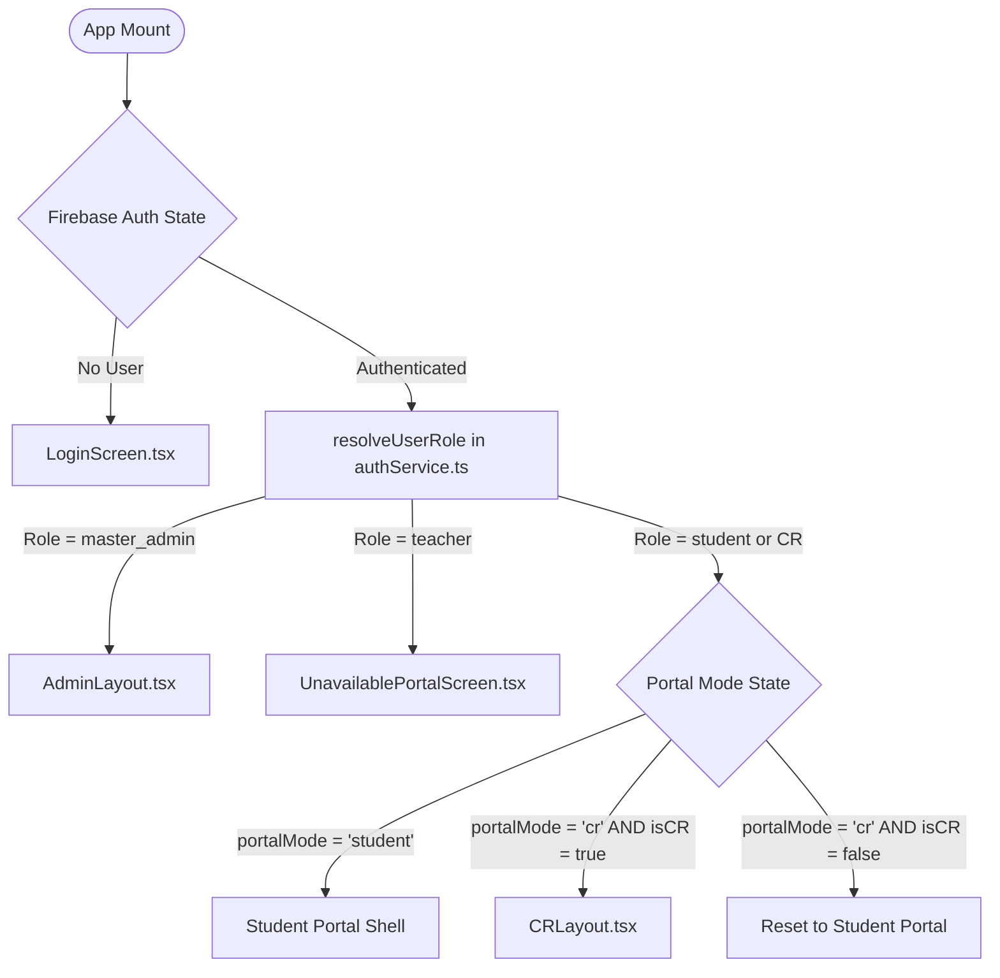
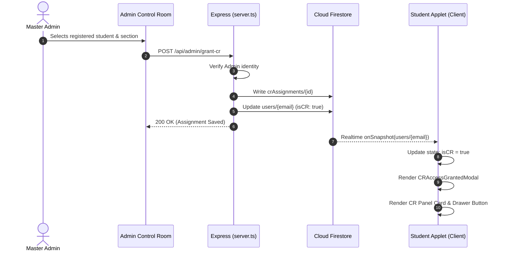

# AWKUM ClassHub — Technical Architecture & System Map

**Abdul Wali Khan University Mardan · Garden Campus**  
*Document Version: 2.2 · Status: Authoritative System Documentation*

---

## 1. System Overview

AWKUM ClassHub is a multi-role web application designed for the Department of Computer Science & Software Engineering at Abdul Wali Khan University Mardan (AWKUM). It provides authenticated portals for:
1. **Students**: Access to daily schedules, course materials, assignment submissions, personal attendance tracking, and university announcements.
2. **Class Representatives (CRs)**: Operational tools for recording single daily whole-class attendance, generating printable A4 PDF reports, managing rosters, and dispatching faculty alerts.
3. **Faculty / Teachers**: Subject courseware management, assignment publication, student grading, real-time CR alert notifications, and schedule tracking.
4. **Master Administrator**: Complete governance over user roles, CR appointments/revocations, faculty mappings, curriculum subjects, university branding, and security audit logs.

```mermaid
graph TD
    subgraph ClientLayer [Client Layer - React 19 SPA]
        SPA[React 19 Single Page Application]
        AuthHook[Firebase Auth SDK Listener]
        RoleRouter[Role & Hash Router]
        StudentPortal[Student Portal Views]
        CRPortal[CR Workspace Views]
        AdminPortal[Master Admin Layout]
    end

    subgraph ServerLayer [Backend Layer - Express on Node.js]
        Server[Express Server (server.ts)]
        RBACMiddleware[Server-Side RBAC Enforcement]
        CloudinaryProxy[Cloudinary Upload Proxy]
        AdminSDK[Firebase Admin SDK]
    end

    subgraph DataLayer [Cloud Services & Persistence]
        FirebaseAuth[(Firebase Authentication)]
        Firestore[(Cloud Firestore Database)]
        CloudinaryStorage[(Cloudinary Media CDN)]
    end

    SPA --> AuthHook
    AuthHook --> FirebaseAuth
    FirebaseAuth --> RoleRouter
    RoleRouter -->|Role: student| StudentPortal
    RoleRouter -->|Role: student + CR Active| CRPortal
    RoleRouter -->|Role: master_admin| AdminPortal

    SPA -->|RBAC Guarded Calls| Server
    Server --> RBACMiddleware
    RBACMiddleware --> AdminSDK
    AdminSDK --> Firestore
    Server --> CloudinaryProxy
    CloudinaryProxy --> CloudinaryStorage
```

---

## 2. Repository & Directory Structure

```text
/
├── .env.example               # Environment template with safe placeholders
├── architecture.md            # Authoritative technical map and data flows
├── design.md                  # Comprehensive UI/UX tokens and interaction guidelines
├── rules.md                   # Non-negotiable engineering invariants and security rules
├── DATA_MODEL.md              # Database schemas and collection relationships
├── FIREBASE_SETUP.md          # Existing Firebase project setup and diagnostics
├── SECURITY.md                # Threat model, authorization boundaries, and audit rules
├── TESTING.md                 # Verification test matrix and automated test scripts
├── DEPLOYMENT.md              # Build, release, and deployment procedures
├── AGENTS.md                  # Instructions for future AI coding agents
├── CHANGELOG.md               # Chronological record of meaningful system changes
├── API_REFERENCE.md           # Express backend REST endpoints contract
├── DECISIONS.md               # Architectural Decision Records (ADRs)
├── firebase-blueprint.json    # Firestore collection schema definitions
├── firestore.rules            # Firestore security rules enforced at database boundary
├── index.html                 # HTML5 entry point with AWKUM branding and meta tags
├── metadata.json              # Applet metadata, capabilities, and permissions
├── package.json               # Dependencies and scripts (React 19, Vite, Express, Firebase)
├── server.ts                  # Express full-stack server and RBAC authorization API
├── tsconfig.json              # TypeScript compiler configuration
├── vite.config.ts             # Vite configuration with React and Tailwind plugins
└── src/
    ├── main.tsx               # Client entry point mounting App.tsx
    ├── App.tsx                # Master state controller, session manager, and role router
    ├── index.css              # Global styles and Tailwind CSS v4 import
    ├── components/
    │   ├── admin/             # Master Admin Control Room components
    │   ├── common/            # Shared shell components (Header, BottomNav, SideDrawer, AwkumLogo)
    │   ├── cr/                # Class Representative views and modals
    │   │   ├── CRAccessGrantedModal.tsx       # Appointment confirmation dialog (Screen 03)
    │   │   ├── CRAttendanceCorrectionModal.tsx # Formal amendment workflow
    │   │   ├── CRAttendanceHistoryView.tsx    # Archived sessions and report list (Screen 12)
    │   │   ├── CRAttendanceMarkingView.tsx    # Single daily attendance marking (Screen 06-08)
    │   │   ├── CRClassRosterView.tsx          # Class student directory (Screen 05)
    │   │   ├── CRDashboardView.tsx            # CR hero metrics & quick actions
    │   │   ├── CRLayout.tsx                   # CR Workspace layout and navigation
    │   │   ├── CRNotifyTeacherView.tsx        # Faculty alert dispatcher (Screen 11)
    │   │   ├── CRPdfModal.tsx                 # Authentic A4 PDF preview modal (Screen 10)
    │   │   ├── CRProfileView.tsx              # CR appointment and profile details (Screen 13)
    │   │   └── CRSchedulePlannerView.tsx      # Manual recurring weekly schedule editor & exceptions
    │   └── screens/           # Student Portal screens
    │       ├── AssignmentsScreen.tsx          # Assignment list, details, and submissions
    │       ├── ClassesScreen.tsx              # Enrolled subjects and document library
    │       ├── HomeScreen.tsx                 # Student dashboard, active class progress bar, and countdown
    │       ├── LoginScreen.tsx                # Unified login and account creation
    │       ├── NotificationsScreen.tsx        # University alerts and announcements
    │       ├── ProfileScreen.tsx              # Student personal record and settings
    │       ├── ProgressScreen.tsx             # Attendance progress charts and breakdown
    │       ├── ScheduleScreen.tsx             # Interactive recurring semester timetable & day view
    │       ├── SubjectDetailView.tsx          # Subject syllabus and file explorer
    │       └── UnavailablePortalScreen.tsx    # Fallback for unconfigured roles
    ├── data/
    │   ├── adminData.ts       # Admin entities, user types, and RBAC utility functions
    │   ├── classRosterData.ts # Enrolled students for class sections
    │   └── portalData.ts      # Prototype academic constants and student profiles
    └── lib/
        ├── attendanceService.ts   # Whole-class attendance storage, queries, and listeners
        ├── authService.ts         # User authentication, role resolution, and CR assignment
        ├── brandingService.ts     # Dynamic logo and university visual identity
        ├── firebase.ts            # Client-side Firebase SDK initialization
        ├── pdfReportService.ts    # Client-side A4 attendance PDF generator (jsPDF)
        ├── scheduleEngine.ts      # Deterministic Karachi timezone weekly recurrence, validation, & timers
        ├── scheduleService.ts     # Firestore CRUD, history snapshots, and real-time listeners for timetable
        └── teacherAlertService.ts # Faculty alert dispatching and cooldown management
```

---

## 3. Frontend Architecture & Role Routing

### 3.1 Bootstrap & Shell Composition
The application runs as a React 19 Single Page Application. Rendering begins in `src/main.tsx`, mounting `App.tsx` into the DOM.

`App.tsx` acts as the root coordinator:
1. **Authentication Observer**: Tracks Firebase Auth state via `onAuthStateChanged`.
2. **Account Synchronizer**: Listens to real-time changes in `users/{email}` and `crAssignments`.
3. **Session Restoration**: Restores remembered sessions from `localStorage` upon page load.
4. **Conditional Role Router**:
   - `!currentUser`: Renders `LoginScreen`.
   - `userRole === 'master_admin'`: Renders `AdminLayout`.
   - `userRole === 'teacher'`: Renders `UnavailablePortalScreen` (or Teacher panel).
   - `isUserCR(currentUser) && portalMode === 'cr'`: Renders `CRLayout`.
   - Default: Renders the standard **Student Portal** with `Header`, active tab screen, `BottomNav`, and `SideDrawer`.



### 3.2 Dual-Experience State Machine
Class Representatives have access to both their personal Student Portal and the CR Control Center. The user switches between them via `setPortalMode('student' | 'cr')` and URL hash synchronization (`#cr` / `#student`). If a student's CR status is revoked in real time, `App.tsx` resets `portalMode` to `'student'` and clears the URL hash.

---

## 4. Backend Architecture (`server.ts`)

The Express server handles trusted operations that cannot safely be performed directly by untrusted client browsers:
- **Express + Vite**: In development (`NODE_ENV !== 'production'`), Vite is mounted as Express middleware. In production, static built files in `dist/` are served.
- **Firebase Admin SDK**: Initializes Firestore Admin for server-side role mutations and system audits.
- **Cloudinary Integration**: Handles secure document and image uploads via `/api/upload`.
- **RBAC Endpoints**:
  - `ALL /api/auth/validate-cr`: Validates CR assignment status.
  - `POST /api/admin/grant-cr`: Grants CR status (restricted to `hasnainbuilds724656@gmail.com`).
  - `POST /api/admin/revoke-cr`: Revokes CR status immediately.
  - `POST /api/cr/verify-operation`: Checks class assignment before allowing attendance/alert operations.
  - `GET /api/admin/cr-assignments`: Lists all active/historical CR assignments.
  - `GET /api/health`: Diagnostics and service status.

---

## 5. Role Granting & Revocation Workflows

### 5.1 Granting CR Access
When the Master Admin grants CR access in the Admin Control Room:
1. Client calls `/api/admin/grant-cr`.
2. Server validates that `adminEmail === hasnainbuilds724656@gmail.com`.
3. Server revokes any existing active CR for that section (one active CR per class rule).
4. Server creates a new document in `crAssignments` bound to the student's UID and email.
5. Server updates `users/{email}` with `role: 'cr'`, `roles: ['student', 'cr']`, `isCR: true`.
6. Client listener receives update:
   - Appointment confirmation modal (`CRAccessGrantedModal.tsx`) appears.
   - CR Panel card appears on `HomeScreen.tsx`.
   - CR Control Panel button appears in `SideDrawer.tsx`.



### 5.2 Revoking CR Access
1. Master Admin triggers revocation via `/api/admin/revoke-cr`.
2. Server sets `status: 'revoked'` in `crAssignments` and updates user profile.
3. Student Applet listener immediately detects revocation:
   - Resets `portalMode` from `'cr'` to `'student'`.
   - Closes CR modals and strips URL hash.
   - Hides CR entry points from Home dashboard and SideDrawer.
   - Subsequent calls to `/api/cr/verify-operation` receive `403 Forbidden`.

### 5.3 Subject Teacher Invitation Credentials Architecture
Faculty assignment uses a secure, subject-specific invitation credential workflow rather than searching for pre-existing Gmail accounts:
1. **Automated Credential Generation**:
   - Whenever Master Admin creates an unassigned subject or regenerates credentials in `TeacherAssignmentsView`, the system generates a cryptographically unique Invitation Code (e.g. `CS101-7M9K2X`) and a 12-character high-entropy invitation password.
   - Only the SHA-256 hex hash of the password is saved into Firestore (`subjectInvitations/{id}`).
   - Plaintext credentials are displayed once to the authorized Master Admin with 1-click Copy Code and Copy Password controls.
2. **Universal Login Integration**:
   - In `LoginScreen.tsx`, users can toggle between `Existing Account Login` and `Join as Subject Teacher`. No separate teacher login page or detached URL is required.
   - Faculty members enter the Subject Invitation Code and Invitation Password directly.
3. **Cryptographic Backend Verification (`POST /api/teacher-invitations/verify`)**:
   - The backend hashes the submitted password with SHA-256 and compares it against the stored hash in `subjectInvitations`.
   - Checks that the invitation is `active`, has not expired or been revoked, and confirms the single-active-teacher policy for the subject.
   - Fetches verified subject details (name, code, credit hours, assigned class) directly from Firestore and displays them for confirmation.
4. **Teacher Registration & Email Verification**:
   - Faculty enters full name, university email, and chooses an account password.
   - Firebase Authentication creates the account (or links an existing account after password verification).
   - The invitation is reserved (`status: 'reserved'`) for concurrency protection while Firebase sends an email verification link.
   - Once the faculty verifies their email, the client triggers `POST /api/teacher-invitations/claim`.
5. **Atomic Claim & Workspace Activation**:
   - The backend independently verifies `emailVerified: true` from Firebase Auth.
   - Atomically updates `subjectInvitations` to `status: 'claimed'`, updates the subject to `status: 'Assigned'`, creates `subjectTeacherAssignments`, updates the user's profile with `role: 'teacher'`, and writes an immutable audit record.
   - The teacher is immediately transitioned into their Teacher Workspace.
6. **Preserved Learning Resources Guarantee**:
   - Revoking a teacher access (`POST /api/admin/revoke-subject-teacher`) resets the subject to unassigned and generates fresh invitation credentials, while preserving all course documents (`documents`), assignments (`assignments`), and student submissions (`submissions`).

---

## 6. Daily Whole-Class Attendance Architecture

### 6.1 The Single Daily Record Lifecycle
Attendance is recorded strictly **once per calendar day per section**:
1. **Initiation**: The CR selects the date (defaults to today's date).
2. **Roster Population**: System loads the enrolled roster for `currentUser.assignedClass`.
3. **Marking**: CR marks students Present or Absent (defaults to Present for speed).
4. **Validation & Review**: System warns if any student remains unrecorded.
5. **Persistence**: Record is saved to `attendanceSessions/{classId}_{date}`:
   - Sets `finalized: true`.
   - Calculates `presentCount`, `absentCount`, `attendancePercentage`.
   - Stores individual student status map in `records`.
6. **Confirmation & PDF Generation**:
   - Screen 09 modal displays success recap.
   - In-app A4 PDF report preview modal (`CRPdfModal.tsx`) renders verified report.
   - System updates personal attendance for enrolled students in real time.

```mermaid
flowchart TD
    CRUser([Class Representative]) --> OpenAtt[Open Attendance View]
    OpenAtt --> LoadRoster[Fetch Enrolled Roster for Class]
    LoadRoster --> CheckExisting{Session Exists for Date?}
    
    CheckExisting -->|Yes & Finalized| ViewLocked[Display Locked Banner & PDF Actions]
    CheckExisting -->|No / Unfinalized| MarkRoster[Mark Present / Absent]
    
    MarkRoster --> ReviewModal[Open Review & Confirm Dialog]
    ReviewModal --> SaveSession[Save to attendanceSessions/{id}]
    SaveSession --> SuccessModal[Screen 09: Attendance Saved Successfully]
    
    SuccessModal --> ViewPDF[Screen 10: CRPdfModal A4 Preview]
    SuccessModal --> GoHistory[Screen 12: Attendance History View]
    SuccessModal --> BackDash[Return to CR Dashboard]
```

### 6.2 Controlled Revision Workflow
If an error was made on a finalized date:
1. CR or Admin opens the Amendment modal (`CRAttendanceCorrectionModal.tsx`).
2. Changes are made with a mandatory audit reason.
3. System saves a revised session document, adding an item to `revisions[]` (e.g., `Rev #1`).
4. Re-generated PDF reports clearly display the revision banner and justification.

---

## 7. Faculty Notification Architecture

- **Context**: CR dispatches an alert when an upcoming class is about to start.
- **Workflow**:
  1. System checks `todaySchedule` and resolves the assigned instructor.
  2. Rate limit cooldown is evaluated (minimum 60 seconds between alerts for the same subject).
  3. Notification record is written to `notifications` collection and local audit registry.
  4. System confirms dispatch without claiming external delivery unless verified.

---

## 8. Data Storage & Media Architecture (Cloudinary)

- **Purpose**: Storage of assignment attachments, submitted coursework, and university branding logos.
- **Security**: Uploads are proxied through `/api/upload` on the Express server. Server holds `CLOUDINARY_API_SECRET`. Client never receives secret credentials.
- **Client Unsigned Upload**: Configured in `.env.example` as `VITE_CLOUDINARY_UPLOAD_PRESET` for direct student document submissions when proxying is bypassed.

---

## 9. Security Boundaries & Threat Model

| Boundary | Enforcing Mechanism | Failure Behavior |
| :--- | :--- | :--- |
| **Database Access** | `firestore.rules` | Firestore returns `permission-denied`. Operation fails cleanly. |
| **Privileged APIs** | Express server role validation in `server.ts` | Server returns `403 Forbidden` with descriptive error payload. |
| **Client Navigation** | React state & URL hash observer in `App.tsx` | Unauthorized `#cr` attempts redirect immediately to Student Portal. |
| **File Storage** | Server-side Cloudinary credentials | Server rejects unauthenticated or oversized file payloads ($>100\text{MB}$). |

---

## 10. Four-Portal Coordinated Workspaces & Persistent Role Replacement

1. **Curriculum Subjects Persistence (`src/lib/subjectService.ts`)**:
   - Master Admin can dynamically add, edit, and assign teachers to curriculum subjects.
   - Synchronized in real time with Cloud Firestore `subjects` collection and mirrored across all portals.
2. **Teacher Replacement & Workspace Continuity**:
   - When Master Admin reassigns or appoints a new teacher for a course, the new faculty member automatically inherits the persistent subject workspace.
   - All courseware documents (`documents`), assignments (`assignments`), student submissions (`submissions`), and grades (`grades`) remain intact and attached to the subject.
3. **CR Replacement & Class Attendance Continuity**:
   - Canonical whole-class daily attendance sessions (`attendanceSessions/${classId}_${date}`) and enrolled student rosters persist without disruption when a Class Representative is replaced or revoked.
   - Revoking CR status preserves the underlying student profile and credentials.
4. **Real-Time Faculty Alerts**:
   - CR arrival notifications stream live to the Teacher Portal dashboard via `subscribeToTeacherIncomingAlerts`.
5. **In-Built Document Viewer**:
   - Fully client-side responsive viewer supporting PDF (with iframe embedding and external link fallback), PPT/PPTX presentation mode with slide navigation and concept outlines, and DOC/DOCX reader mode with zoom (70%–150%) and page controls.
